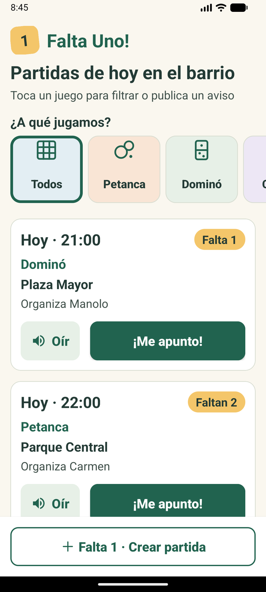
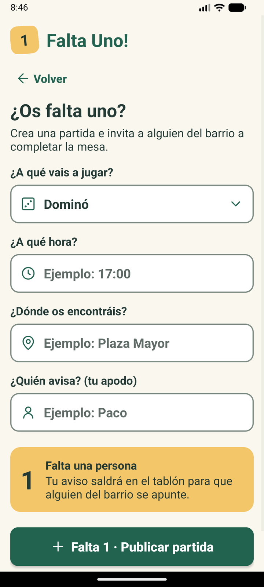

# Falta Uno!

**Una partida cerca. Un buen rato juntos.**

Falta Uno! es una app Android para que las personas mayores del barrio encuentren o convoquen partidas de ocio tradicional (dominó, cartas, petanca y parchís) en parques y centros cívicos. Funciona como un tablón de anuncios: se ven las partidas de hoy, uno se apunta con un solo toque y, si a una mesa le falta gente, se publica un aviso de "¡Falta 1!".

Sin registro, sin contraseñas y sin chats: solo un apodo. Letra grande, botones grandes, alto contraste y lectura en voz alta.

<p align="center">
  
  &nbsp;&nbsp;
  
</p>

> MVP del proyecto de 2.º DAM (Monlau) · Adrián Iturbe, Pol Cañizares, Oriol Torres y Enrique Flores.

## Enlaces

| | |
|---|---|
| Prototipo en Figma | [Abrir el prototipo](https://www.figma.com/proto/WCZAZMoVczL6dm7Y8frJ16/Proyecto?page-id=0%3A1&node-id=28-3) |
| Documentos SDD | [`.ai/`](.ai/): [`constitution.md`](.ai/constitution.md), [`spec.md`](.ai/spec.md), [`plan.md`](.ai/plan.md), [`tasks.md`](.ai/tasks.md) y [`AGENTS.md`](.ai/AGENTS.md) |
| Presentación | [`presentacion/index.html`](presentacion/index.html): descarga el repositorio y ábrela en el navegador (flechas o clic para pasar, **N** para las notas, **F** para pantalla completa) |
| Reparto de ramas | [`GUIA_RAMAS.md`](GUIA_RAMAS.md) |
| Uso de la IA | [`uso-ia.md`](uso-ia.md) |

## Qué hace

- **Ver las partidas de hoy** en tarjetas grandes: hora, juego, lugar, quién organiza y cuántos faltan.
- **Filtrar por juego** con casillas de colores: Todos, Petanca, Dominó, Cartas y Parchís.
- **Apuntarse con un toque**: resta una plaza; cuando no quedan, el botón pasa a "Partida llena".
- **Oír la partida**: el botón del altavoz la lee en voz alta con la voz de Android en español.
- **Crear un aviso "¡Falta 1!"**: juego, hora, lugar y apodo. Avisa si falta la hora o el lugar, si la hora no se entiende o si ya ha pasado.
- **Guardado en el móvil**: las partidas se guardan en `SharedPreferences` (JSON) y no se pierden al cerrar la app. Al cambiar de día se borran y las de hoy cuya hora ya pasó se ocultan.

## Cómo ejecutarlo

1. Instala **Android Studio**.
2. En **Tools > SDK Manager > SDK Platforms**, instala **Android 14.0 (API 34)**.
3. **File > Open** y elige la carpeta del repositorio. Si pregunta, pulsa **Trust Project**.
4. En **File > Settings > Build, Execution, Deployment > Build Tools > Gradle**, pon el **Gradle JDK** en **17** (si no lo tienes: *Download JDK… > 17 > Eclipse Temurin*). El proyecto usa Gradle 8.2, que no funciona con versiones más nuevas de Java.
5. Espera al **Gradle Sync**. Si Android Studio ofrece actualizar Gradle o el plugin de Android, **no lo aceptes**.
6. Elige un emulador o un móvil por USB y pulsa **▶ Run 'app'**.

Requisitos del proyecto: `minSdk 24`, `targetSdk 34`, Java 8 y XML, sin librerías externas aparte de AndroidX y Material.

> Si el botón de voz avisa de que no hay voz en español, instálala en el dispositivo: *Ajustes > Sistema > Idiomas > Síntesis de voz*.

## Quién hizo qué

| Persona | Rama | Parte |
|---|---|---|
| **Pol Cañizares** | `PolCanizares` | Pantalla principal y filtros (`MainActivity`, `activity_main.xml`) |
| **Adrián Iturbe** | `AdrianIturbe` | Tarjeta de partida y voz (`PartidasAdapter`, `item_partida.xml`, `GestorVoz`) |
| **Oriol Torres** | `OriolTorres` | Formulario "Falta 1" y validación (`NuevaPartidaActivity`, `activity_nueva_partida.xml`) |
| **Enrique Flores** | `EnriqueFlores` | Modelo y datos (`Partida`, `GestorPartidas`), integración de las ramas, diseño del Figma en la app y presentación |

Cada parte se integró en `main` con una Pull Request (#1 a #7), sin force push y comprobando que compilaba antes de fusionar.

## Estructura

```text
app/src/main/java/com/faltauno/app/
├── model/Partida.java            Datos de una partida (y conversión a JSON)
├── data/GestorPartidas.java      Guardado en el móvil, plazas, filtro y partidas de hoy
├── voz/GestorVoz.java            Lectura en voz alta (TextToSpeech)
└── ui/
    ├── MainActivity.java         Tablón, filtros y "Me apunto"
    ├── PartidasAdapter.java      Tarjetas de la lista
    ├── NuevaPartidaActivity.java Formulario "¿Os falta uno?"
    └── Avisos.java               Mensajes grandes (Snackbar)
```

## Limitaciones

- **Sin servidor:** las partidas solo se guardan en el móvil donde se crean; dos vecinos no ven las partidas del otro.
- **Solo partidas de hoy:** no se puede elegir otro día y al cambiar de día se borran todas.
- **Tablet en horizontal:** funciona, pero las tarjetas se estiran a todo el ancho; falta adaptar el diseño.
- **Sin iconos de juego en las tarjetas** (Requisito 1 del `spec.md`): solo están en las casillas de filtro.
- **No se puede borrar uno de una partida** después de apuntarse.
- **Probado en emulador** (móvil y tablet con API 37); falta probarlo en un móvil real y con personas mayores (tareas T-8 y T-9).
- **Falta el Gradle wrapper** (`gradlew`) en el repositorio: Android Studio funciona sin él, pero para compilar desde la terminal hay que generarlo.
